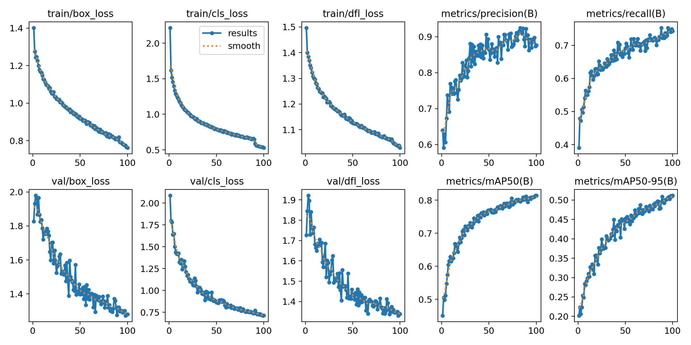
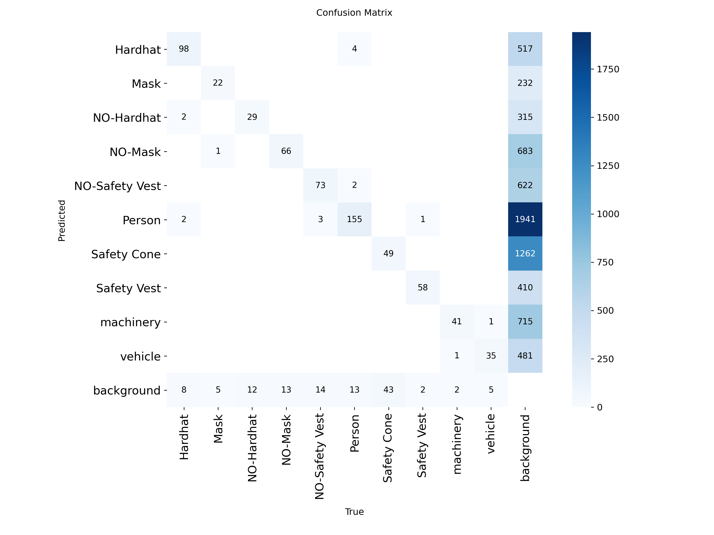
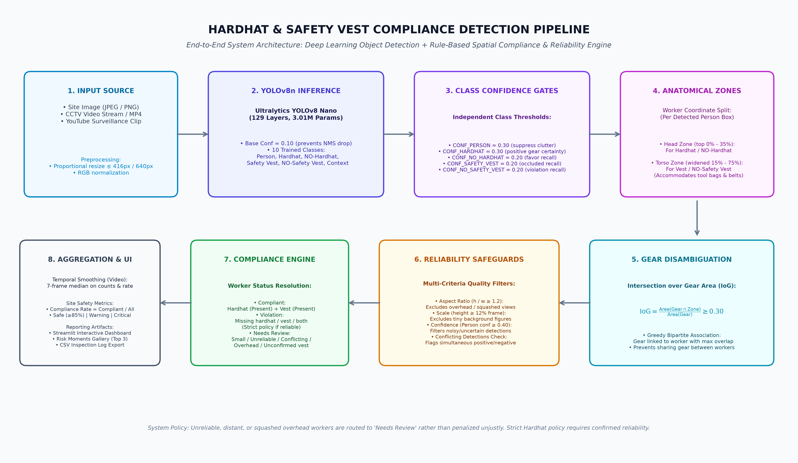

# Hardhat and Safety-Vest Compliance Detection for Construction Workers Using YOLOv8

**Course:** AI2002 — Artificial Intelligence  
**Path:** Path A (Software-Based Implementation)  
**Deliverable:** Final Project Report  
**GitHub Repository:** `https://github.com/mibrahimshoaib56/ppe-compliance`  
**Date:** November 2026  

---

## Executive Summary

Personal Protective Equipment (PPE) compliance is critical for preventing head injuries and vehicle-strike accidents on construction sites. However, manual safety monitoring by on-site safety personnel has limited coverage and depends on periodic visual inspections.

This project implements an automated compliance surveillance workflow combining deep-learning object detection with spatial geometric rule logic and temporal video filtering. The detector is an Ultralytics **YOLOv8n** model (129 layers, 3,012,798 parameters as trained, and 73 layers with 3,134,894 parameters when fused) trained on the **Construction Site Safety (v28)** dataset across 10 classes, achieving a validation $\text{mAP}_{50}$ of **0.813** and test $\text{mAP}_{50}$ of **0.754**.

To determine compliance from raw bounding boxes, a Python spatial compliance engine was developed. The engine partitions worker bounding boxes into anatomical head (top 0%–35%) and widened torso (middle 15%–75%) zones, associates equipment using **Intersection over Gear Area ($\text{IoG} \ge 0.30$)**, and applies reliability safeguards based on aspect ratio, bounding box height fraction, detection confidence, and detection conflicts. For video processing, a **7-frame rolling median temporal filter** operates in a post-processing pass over surrounding frames to smooth aggregate frame counts (total workers, violations, compliant counts) and the compliance rate over time. It does not alter bounding boxes, per-worker statuses, or playback video frames.

Evaluation on 15 test photos collected from Google Images with labels made by the group by visual inspection yielded an exact image-level match of **13.3%** (2 of 15 images). Within $\pm 1$ worker count, accuracy was **93.3%** (14 of 15) for violations and **26.7%** (4 of 15) for compliant workers, with a Mean Absolute Error (MAE) of **0.60** for violations and **3.73** for compliant counts. A naive baseline that predicts zero violations everywhere would be within $\pm 1$ on 12 of 15 images (**80%**), because the ground-truth key contains only 7 violations among 88 workers. Across the 15 photos, 69 workers were detected versus 88 true workers (counts only; detections were not matched one by one); 37 received a verdict (25 compliant, 12 violations), while 32 were sent to "Needs Review".

---

## Table of Contents
1. [Introduction & Problem Justification](#1-introduction--problem-justification)
2. [Objectives & Selected Path](#2-objectives--selected-path)
3. [Algorithm Justification: Why Detection & YOLOv8?](#3-algorithm-justification-why-detection--yolov8)
4. [Dataset Description & Preprocessing](#4-dataset-description--preprocessing)
5. [Model Training & Empirical Results](#5-model-training--empirical-results)
6. [Compliance Engine Architecture](#6-compliance-engine-architecture)
7. [System-Level Evaluation & Diagnostics](#7-system-level-evaluation--diagnostics)
8. [Failure Case Analysis](#8-failure-case-analysis)
9. [Video Surveillance & Temporal Smoothing](#9-video-surveillance--temporal-smoothing)
10. [Application Architecture & User Interface](#10-application-architecture--user-interface)
11. [Limitations & Future Improvements](#11-limitations--future-improvements)
12. [Conclusion](#12-conclusion)
13. [References](#13-references)

---

## 1. Introduction & Problem Justification

Construction environments contain hazards including moving machinery, overhead loads, scaffolding, and excavations. Safety regulations mandate two primary items of personal protective equipment:
1. **Safety Hardhats:** To protect against falling objects, overhead hazards, and head impacts.
2. **High-Visibility Safety Vests:** To ensure worker visibility around heavy construction equipment and vehicle traffic.

### Manual Safety Monitoring
On construction sites, safety officers typically conduct periodic walkthrough inspections. However:
* **Intermittent Coverage:** Walkthroughs observe workers only at specific times; gear may be removed when inspectors are absent.
* **Spatial Scale:** Multi-level structures, scaffolding, and excavation areas cannot be monitored simultaneously from the ground.
* **Observer Fatigue:** Manual tracking over long shifts can lead to unobserved infractions.

### Automated Vision Approach
Fixed cameras can provide continuous visual feeds. However, using object detection for safety monitoring requires establishing spatial attribution—confirming that a detected hardhat or vest is positioned within the correct anatomical zone of a detected worker—while separating ambiguous views and occlusions from clear compliance decisions.

---

## 2. Objectives & Selected Path

This project was developed under **Path A (Software-Based Implementation)** of the AI2002 course.

### Project Objectives
1. **Object Detection Model:** Train a YOLOv8 object detector on construction site safety gear and person classes.
2. **Rule-Based Compliance Logic:** Implement a Python compliance engine on top of detector outputs to extract anatomical zones, compute gear-to-person overlap, and calculate site compliance percentages.
3. **Reliability Safeguards:** Implement filtering rules to prevent false violation flags on background objects, distant figures, crouching postures, and overhead perspectives.
4. **Video Processing with Temporal Filtering:** Implement post-processing temporal smoothing to stabilize aggregate frame counts and compliance rates across video frames.
5. **Streamlit Interface:** Provide a web interface supporting image upload, video processing with annotated playback, inspection summary metrics, and CSV reporting.
6. **Empirical Evaluation:** Benchmark the pipeline against visual ground-truth counts on test photos across confidence thresholds.

---

## 3. Algorithm Justification: Why Detection & YOLOv8?

### 3.1 System Input, Output, and Supported Decision
The pipeline takes a single RGB image (or video frame) as input. It outputs bounding box coordinates $[x_1, y_1, x_2, y_2]$, class detections, per-worker compliance status (`Compliant`, `Violation`, or `Needs Review` with diagnostic reasons), and an aggregate site summary (total workers, compliant count, violation count, and compliance percentage). This supports on-site safety officers by automatically flagging scenes or zones requiring immediate manual inspection, triaging potential infractions, and logging compliance trends over time.

### 3.2 Object Detection vs. Image Classification
Image classification assigns a single label to an entire image or crop. In construction scenes:
* **Multiple Instances:** Scenes contain multiple workers at varying distances simultaneously; whole-image classification cannot evaluate individual workers.
* **Spatial Explainability:** Classification does not provide bounding box coordinates showing which worker is missing which item.
* **Detection Capability:** Object detection outputs bounding box coordinates $[x_1, y_1, x_2, y_2]$, class labels, and confidence scores for every detected person and piece of gear, enabling spatial reasoning.

### 3.3 YOLOv8 Architecture
YOLOv8 uses an anchor-free convolutional architecture that detects objects in a single pass:
* **Anchor-Free Head:** Decouples object classification and bounding-box regression, which assists in detecting small objects (such as hardhats) alongside larger objects (such as vehicles).
* **C2f Modules:** Integrate cross-stage partial connections with two convolutions to enhance feature gradient flow across scales.

### 3.4 YOLOv8 Nano (`yolov8n`) Configuration
For this project, `yolov8n.pt` was selected:
* **Parameters:** **3,012,798 parameters** (129 layers) as trained; **3,134,894 parameters** (73 layers) when fused for validation.
* **Compute Complexity:** **8.2 GFLOPs** as trained (8.6 GFLOPs fused).
* **Hardware Context:** Client-side testing runs on CPU hardware without a local CUDA GPU.

---

## 4. Dataset Description & Preprocessing

The model was trained on the **Construction Site Safety (v28)** dataset from Roboflow Universe (CC BY 4.0 license).

### 4.1 Dataset Composition & Splits
The dataset contains **2,801 total images** at $640 \times 640$ resolution:

| Split | Image Count | Percentage | Split Characteristics |
|---|:---:|:---:|---|
| **Training** | 2,605 | 93.0% | Sampled training images are baked-in mosaics with cutout patch squares |
| **Validation** | 114 | 4.1% | 114 images (natural images, not individually inspected) |
| **Testing** | 82 | 2.9% | Held-out benchmark test set of natural photographic scenes |
| **Total** | **2,801** | **100.0%** | YOLO annotation format |

### 4.2 Class Hierarchy (10 Classes)

| Class ID | Class Name | Function in Compliance Pipeline |
|:---:|---|---|
| `0` | `Hardhat` | Positive target gear (head protection present) |
| `1` | `Mask` | Contextual equipment |
| `2` | `NO-Hardhat` | Negative target gear (evidence of missing helmet) |
| `3` | `NO-Mask` | Contextual equipment |
| `4` | `NO-Safety Vest` | Negative target gear (evidence of missing vest) |
| `5` | `Person` | Primary anchor detection |
| `6` | `Safety Cone` | Contextual hazard marker |
| `7` | `Safety Vest` | Positive target gear (torso protection present) |
| `8` | `machinery` | Contextual equipment |
| `9` | `vehicle` | Contextual equipment |

The compliance engine uses classes 0, 2, 4, 5, and 7. The remaining classes are treated as context.

### 4.3 Training Set Characteristics
Sampled training images are baked-in mosaics with cutout squares, which forces the network to detect partial equipment features. The held-out test split consists of natural photographic scenes.

---

## 5. Model Training & Empirical Results

Training was conducted on a **Kaggle GPU instance (NVIDIA Tesla T4)** using the Ultralytics framework.

### 5.1 Training Setup
* **Framework:** Ultralytics 8.4.215
* **Epochs:** 100
* **Batch Size:** 16
* **Input Resolution:** $640 \times 640$ pixels
* **Optimizer:** AdamW (auto-selected, learning rate $0.000714$, momentum $0.9$)
* **Training Time:** **0.565 hours** for 100 epochs
* **Speed on Tesla T4 (Test Split):** 1.8 ms preprocess, 6.8 ms inference, 2.3 ms postprocess per image. No CPU timing was measured.

### 5.2 Training Convergence & Validation Metrics

From the Kaggle training log and `results.csv`:
* **Epoch 100 Training Losses:** Box loss **0.7619**, Class loss **0.5279**, DFL loss **1.03**
* **Validation Losses at Epoch 100:** Box loss **1.281**, Class loss **0.714**, DFL loss **1.339**
* **Validation mAP at Epoch 100:** $\text{mAP}_{50} = \mathbf{0.814}$, $\text{mAP}_{50-95} = \mathbf{0.512}$
* **Best Model Weights (`best.pt`):** Validation $\text{mAP}_{50} = \mathbf{0.813}$, $\text{mAP}_{50-95} = \mathbf{0.511}$



### 5.3 Held-Out Test Set Performance (82 Images, 760 Boxes)

From `eval/results/test_metrics.txt`:

| Metric | Test Split Value |
|---|:---:|
| **Overall Precision ($P$)** | **0.874** |
| **Overall Recall ($R$)** | **0.702** |
| **Overall $\text{mAP}_{50}$** | **0.754** |
| **Overall $\text{mAP}_{50-95}$** | **0.465** |

#### Per-Class Test Split Breakdown (`test_metrics.txt`)

| Class | Precision ($P$) | Recall ($R$) | $\text{AP}_{50}$ | $\text{AP}_{50-95}$ |
|---|:---:|:---:|:---:|:---:|
| **Hardhat** | 0.959 | 0.809 | 0.905 | 0.593 |
| **Mask** | 0.971 | 0.750 | 0.783 | 0.559 |
| **NO-Hardhat** | 0.807 | 0.561 | 0.545 | 0.281 |
| **NO-Mask** | 0.777 | 0.671 | 0.732 | 0.333 |
| **NO-Safety Vest** | 0.930 | 0.739 | 0.799 | 0.475 |
| **Person** | 0.884 | 0.786 | 0.857 | 0.533 |
| **Safety Cone** | 0.796 | 0.424 | 0.442 | 0.203 |
| **Safety Vest** | 0.896 | 0.849 | 0.902 | 0.597 |
| **machinery** | 0.915 | 0.795 | 0.861 | 0.623 |
| **vehicle** | 0.810 | 0.634 | 0.715 | 0.449 |

`NO-Hardhat` had the lowest $\text{AP}_{50}$ (0.545) and recall (0.561) among target classes. This is likely due to the small pixel size of bare heads at distance and visual variance in hair styles, caps, and skin tones compared to hardhat shapes. This empirical result informed the strict hardhat policy described below.



---

## 6. Compliance Engine Architecture



The compliance logic in [`src/compliance.py`](src/compliance.py) operates on detector outputs using geometric rules.

### 6.1 Two-Stage Confidence Filtering
Running YOLO at a single high confidence threshold can eliminate small pieces of gear. The pipeline applies:
1. **Base Inference:** YOLO predicts at $\text{conf} = 0.10$.
2. **Per-Class Thresholds:**
   * $\text{CONF\_PERSON} = 0.30$
   * $\text{CONF\_HARDHAT} = 0.30$
   * $\text{CONF\_NO\_HARDHAT} = 0.20$
   * $\text{CONF\_SAFETY\_VEST} = 0.20$
   * $\text{CONF\_NO\_SAFETY\_VEST} = 0.20$
   * $\text{CONF\_DEFAULT} = 0.20$

The UI confidence slider (default 0.25) sets `conf_threshold` in `run_detection()` (`src/detector.py`, lines 135–208). YOLO inference is always executed first at a fixed low base confidence of 0.10 (`BASE_YOLO_CONFIDENCE`, line 38) to retain candidate gear boxes. The slider value then scales per-class thresholds via `conf_scale = conf_threshold / 0.25` (`src/detector.py`, line 171). At the default 0.25 (scale 1.0), candidate boxes must meet the unscaled gates: 0.30 for Person and Hardhat, and 0.20 for Vests and negative classes (`src/detector.py`, lines 43–50). Detections surviving this gate enter `evaluate_site_compliance()` (`src/compliance.py`), where person detections with confidence below 0.40 (`MIN_PERSON_CONF`, line 44) are routed to "Needs review: low confidence" rather than receiving definitive violation verdicts.

### 6.2 Anatomical Zone Partitioning
For each person box $[x_1, y_1, x_2, y_2]$ with height $H = y_2 - y_1$:
* **Head Zone:** $y_1 + 0.0 \cdot H$ to $y_1 + 0.35 \cdot H$ (top 35% of person height).
* **Torso Zone:** $y_1 + 0.15 \cdot H$ to $y_1 + 0.75 \cdot H$ (widened middle 15%–75% of person height to accommodate tool belts and gear displacement).

### 6.3 Intersection over Gear Area ($\text{IoG}$) Association
Standard $\text{IoU}$ yields small values when associating small gear boxes with larger person zones. The pipeline computes **Intersection over Gear Area ($\text{IoG}$)**:

$$\text{IoG} = \frac{\text{Area}(\text{Gear Box} \cap \text{Anatomical Zone})}{\text{Area}(\text{Gear Box})}$$

A threshold of $\text{OVERLAP\_THRESHOLD} = 0.30$ requires at least 30% of the gear box to fall within the anatomical zone. Each gear box is assigned to the person zone with the highest overlap ratio, preventing double-counting.

### 6.4 Multi-Criteria Reliability Safeguards
Each detected worker is evaluated against four criteria:
1. **Aspect Ratio Guard (`MIN_UPRIGHT_ASPECT = 1.2`):** Person boxes with $h / w < 1.2$ indicate squashed, overhead, or crouching views. These are assigned `"Needs review: view not upright"` and vest status is set to unknown.
2. **Size Fraction Guard (`MIN_PERSON_HEIGHT_FRAC = 0.12`):** Workers whose height is $< 12\%$ of frame height are assigned `"Needs review: small"`.
3. **Detection Confidence Guard (`MIN_PERSON_CONF = 0.40`):** Person detections with confidence $< 0.40$ are assigned `"Needs review: low confidence"`.
4. **Conflicting Detections Guard:** When both positive and negative gear boxes match to the same person, the status is set to `"Needs review: conflicting detections"`.

### 6.5 Strict Hardhat Enforcement Policy
Because detector recall for `NO-Hardhat` is 0.561, an unhelmeted worker often produces no head detection.
* Under `STRICT_HARDHAT_POLICY = True`: A worker whose head zone has no hardhat detection is classified as a violation (`Missing hardhat`), but only if the person detection passes all reliability guards. Unreliable workers remain in "Needs Review".
* Detector recall for `Hardhat` is 0.809, meaning a missed hardhat detection on a helmeted worker can cause a false violation under strict policy. At confidence 0.25, the pipeline flagged 12 violations against 7 true ones; missed hardhat detections under the strict policy are one possible cause, which was not isolated.

---

## 7. System-Level Evaluation & Diagnostics

The pipeline was evaluated on **15 test photos** collected from Google Images (original pages not recorded). A worker is defined as **compliant** only when wearing both a hardhat and a safety vest. Ground-truth worker counts (`true_compliant`, `true_violations`) were established by the group by visual inspection and recorded in [`eval/ground_truth.csv`](eval/ground_truth.csv) using **key v1**, which counted vest-colored garments without silver retroreflective tape as compliant. Under key v1 (vest-colored garments without reflectors counted as compliant), some mismatches may come from workers whose vests the model does not treat as safety vests.

### 7.1 Quantitative Evaluation at Default Confidence (0.25)

From `eval/results/score_images_report.txt`:

```
========================================================================================================
EVALUATION BENCHMARK SUMMARY (15 Photos, Confidence 0.25):
========================================================================================================
• Total Ground-Truth Workers:              88 workers
• Total Detected Workers:                  69 workers vs 88 in ground truth (counts only; not matched 1:1)
• Judged Workers (Compliant + Violations): 37 / 69 detected (53.6%)
• Needs-Review Workers:                    32 / 69 detected (46.4%)
--------------------------------------------------------------------------------------------------------
• Image-Level Exact Match Accuracy:        2 / 15 images (13.3%)
• Within ±1 Accuracy (Violations):         14 / 15 images (93.3%)
• Within ±1 Accuracy (Compliant):          4 / 15 images (26.7%)
• Mean Absolute Error (Violations):        0.60 workers
• Mean Absolute Error (Compliant):         3.73 workers
--------------------------------------------------------------------------------------------------------
• Violations Flagged by Pipeline:          12 flagged
• Violations Caught (Upper Bound):         5 / 7 true violations (sum of min(pred, true))
--------------------------------------------------------------------------------------------------------
• "Predict Zero Violations" Baseline:      12 / 15 images within ±1 (80.0%)
========================================================================================================
```

The "predict zero violations" baseline achieves 80.0% accuracy within $\pm 1$ because the ground-truth annotations contain only 7 true violations across 88 workers (photo06=2, photo07=1, photo12=2, photo13=2, and 0 for all other images).

### 7.2 Breakdown of "Needs Review" by Reason (32 Workers)

From `score_images_report.txt`:
* **`small` ($< 12\%$ frame height):** **17** (53.1% of review workers)
* **`conflicting detections`:** **6** (18.8%)
* **`low confidence` ($< 0.40$):** **4** (12.5%)
* **`view not upright` ($h/w < 1.2$):** **4** (12.5%)
* **`vest unknown`:** **1** (3.1%)
* **`hardhat unknown`:** **0** (0.0%)
* **`other`:** **0** (0.0%)

### 7.3 Confidence Threshold Sweep (0.15, 0.25, 0.40)

From the evaluation records on these 15 photos:

| Confidence | Detected Workers | Compliant | Violations | Needs Review | Review Rate |
|:---:|:---:|:---:|:---:|:---:|:---:|
| **0.15** | 83 | 27 | 9 | 47 | 56.6% |
| **0.25** | 69 | 25 | 12 | 32 | 46.4% |
| **0.40** | 58 | 20 | 18 | 20 | 34.5% |

*Discussion:* At 0.15, more workers are detected but 47 are sent to review. At 0.40, fewer detections pass the initial filter, so missing gear boxes cause strict hardhat enforcement to raise violation flags to 18. Confidence 0.25 represents the least-bad trade-off on these 15 photos.

---

## 8. Failure Case Analysis

Failure cases were examined and recorded in [`eval/results/failure_cases/`](eval/results/failure_cases/):

### Case 1: Overhead Camera Angle (`sample_images/ppe10.jpg`)
* **Source Image:** `sample_images/ppe10.jpg`
* **Visual Content:** High-angle steep overhead perspective of an equipment operator beside industrial machinery.
* **Empirical Execution (`eval/results/ppe10_check.txt`):** YOLO base inference at confidence 0.10 detects two Person candidates (confidences 0.268 and 0.148), one machinery (0.454), one NO-Safety Vest (0.451), and one Safety Vest (0.234). Both Person detections fall below the `CONF_PERSON = 0.30` per-class gate and are dropped upstream in `run_detection`. Consequently, zero Person bounding boxes enter `evaluate_site_compliance()`, yielding 0 detected workers. The `MIN_UPRIGHT_ASPECT = 1.2` guard is not reached because candidate figures are discarded upstream by the confidence gate.

### Case 2: Posture and Material Occlusion (`eval/test_photos/photo03.jpg`)
* **Source Image:** `eval/test_photos/photo03.jpg`
* **Visual Content:** Work crew gathered on a reinforced construction deck with background scaffolding, tool pouches, and rebar structures partially occluding torso regions.
* **Empirical Diagnostic (`score_images_report.txt`):** True counts: 10 compliant, 0 violations (10 true workers). Pipeline predictions: 3 compliant, 0 violations, 6 total workers detected, 3 routed to "Needs Review" (compliance rate 50.0%). Review reasons breakdown for the 3 review workers: 1 `small` ($< 12\%$ frame height), 1 `view not upright` ($h/w < 1.2$), and 1 `conflicting detections`. Diagnostic status: Compliant Mismatch.

### Case 3: Fluorescent Clothing without Reflective Stripes (`eval/test_photos/photo06.jpg`)
* **Source Image:** `eval/test_photos/photo06.jpg`
* **Visual Content:** Five construction workers on an active roadway worksite, two wearing everyday clothing and three wearing fluorescent solid jackets lacking silver retroreflective stripes.
* **Empirical Diagnostic (`score_images_report.txt`):** True counts: 3 compliant, 2 violations (5 true workers). Pipeline predictions: 1 compliant, 3 violations, 5 total workers detected, 1 routed to "Needs Review" (compliance rate 20.0%). Review reasons breakdown for the 1 review worker: 1 `conflicting detections`. Diagnostic status: Compliant Mismatch, Violation Mismatch.

---

## 9. Video Surveillance & Temporal Smoothing

Video processing in [`src/video.py`](src/video.py) processes an uploaded video, then plays back the annotated result.

### 9.1 Processing Configuration
* **Resolution:** Frames are resized proportionally to a maximum width of 416 px.
* **Stride:** Detection runs on every frame (`PROCESS_EVERY_N = 1`).
* **Duration Cap:** Analysis is capped at the first 30 seconds (`MAX_VIDEO_SECONDS = 30`).
* **Export:** Encodes H.264 MP4 with `yuv420p` pixel format using `imageio-ffmpeg` capped at 30 FPS (`OUTPUT_MAX_FPS = 30`).

### 9.2 Temporal Smoothing Implementation
Temporal smoothing is implemented in `apply_temporal_smoothing()` in `src/video.py`:
* **Smoothed Targets:** `apply_temporal_smoothing()` smooths aggregate frame counts (`total_workers`, `compliant_count`, `violation_count`, `needs_review_count`) and the overall `compliance_rate` across frames. It operates purely on frame-level summary counts, not on individual worker tracks or per-worker compliance statuses, because workers are detected independently per frame without multi-object tracking.
* **Window Size:** 7 consecutive analyzed frames (`TEMPORAL_SMOOTHING_WINDOW = 7`).
* **Window Range:** For frame $i$, the window spans from $i - 3$ to $i + 3$ (clamped at boundaries). Because it uses frames both before and after the current frame, it runs in a post-processing pass after all video frames have been analyzed.
* **Operation:** Computes the median of worker counts, violation counts, and compliance rates across the 7-frame window.

$$\hat{C}_i = \text{round}\left(\text{median}\left(C_{i-3}, \dots, C_{i+3}\right)\right)$$

This suppresses isolated 1-frame detection drops in summary trends while preserving multi-frame non-compliance. In video mode, the Streamlit application displays the annotated video stream rendered with raw per-frame bounding boxes, while presenting smoothed aggregate metrics in the dashboard cards, a smoothed compliance percentage line chart across time, and a gallery of top violation moments.

---

## 10. Application Architecture & User Interface

The application ([`app.py`](app.py)) is implemented with Streamlit:
* **Sidebar:** Mode selection (Image vs. Video), input source selection (Upload file vs. YouTube link), page navigation, and strict hardhat policy toggle.
* **YouTube Ingestion:** When "YouTube link" is selected, the application validates URLs against approved YouTube domain prefixes (`https://www.youtube.com/`, `https://youtube.com/`, `https://m.youtube.com/`, `https://youtu.be/`; `src/youtube.py`, lines 16–21). In `download_youtube()` (`src/youtube.py`, lines 62–190), metadata is pre-queried to reject live streams (lines 125–129) and videos exceeding the 15-minute duration cap (`MAX_YOUTUBE_DURATION_SECONDS = 900`, lines 24, 131–139). Streams are downloaded via `yt-dlp` using the format selector `'best[ext=mp4][height<=480]/bestvideo[ext=mp4][height<=480]+bestaudio[ext=m4a]/bestvideo[height<=480]+bestaudio/best[height<=480]/best'` with `merge_output_format: 'mp4'` (lines 156–163), enforcing a maximum resolution of 480p and a 100 MB filesize limit (`MAX_YOUTUBE_MB = 100`, lines 27, 165). Custom `YouTubeDownloadError` exceptions (lines 34–36) map private/sign-in videos, age restrictions, region blocks, bot verification challenges, and network failures to user-friendly messages advising manual download and file upload.
* **Main Area:** Summary metric cards, annotated image/video display, compliance line chart over time, top violation moments, and CSV export.
* **Testing:** 68 isolated unit tests in `tests/` pass with `python -m pytest -q`.

---

## 11. Limitations & Future Improvements

1. **Small Evaluation Dataset:** The quantitative evaluation set contains only 15 photos with 88 workers and 7 true violations, which limits statistical significance.
2. **Undetected Workers:** 22% of true workers were not detected by the model (69 workers detected vs 88 in the ground truth).
3. **Low Coverage on Verdicts:** Only 37 of 88 true workers received a definitive compliance verdict (25 compliant, 12 violations); 32 detected workers were routed to "Needs Review".
4. **Visual Inspection Labeling:** Ground-truth labels were created by one person's visual inspection without multi-annotator agreement or consensus reviews.
5. **Sampling Bias in Test Photos:** Evaluation photos came from the author's own Google Images search rather than systematically sampled operational camera feeds.
6. **Foreign-Site Domain Gap:** The model was trained on the public Roboflow v28 dataset, which presents a domain gap when applied to construction sites with varying uniforms, untaped garments, or regional gear standards.
7. **Seated and Crouching Workers:** Seated workers were not tested; crouching workers have squashed aspect ratios ($h/w < 1.2$) and are excluded from strict enforcement by the upright aspect guard.
8. **Camera Angles:** Steep downward angles compress human body geometry, triggering the aspect ratio guard and routing workers to review.
9. **Reflective Tape Dependency:** The model does not reliably recognize fluorescent clothing that lacks silver retroreflective striping.
10. **Video Mode Not Quantitatively Evaluated:** Video mode processing was demonstrated and visually verified, but was not quantitatively benchmarked against frame-by-frame ground-truth annotations.

---

## 12. Conclusion

This project implemented a construction PPE compliance detection pipeline combining a YOLOv8n detector with spatial geometric rules. 
* The YOLOv8n model achieved a validation $\text{mAP}_{50}$ of 0.813 and a test $\text{mAP}_{50}$ of 0.754 on the Roboflow dataset test split.
* On 15 real-world test photos with visual ground-truth annotations, the system achieved 93.3% accuracy within $\pm 1$ on violation counts (MAE 0.60), compared to an 80.0% baseline for predicting zero violations everywhere.
* Multi-criteria reliability guards routed 46.4% of detected figures to "Needs Review", primarily due to small figure scale at distance (53.1% of review cases).
* The temporal smoothing filter applies a 7-frame rolling median in a post-processing pass over surrounding frames to smooth aggregate frame counts and compliance rates over time; bounding boxes and playback frames themselves remain raw per-frame detections.

---

## 13. References

1. **Construction Site Safety Dataset (v28):** Roboflow Universe, licensed under CC BY 4.0. Available at: `https://universe.roboflow.com/roboflow-universe-projects/construction-site-safety`
2. **Ultralytics YOLOv8:** Jocher, G., Chaurasia, A., & Qiu, J. (2023). Ultralytics YOLOv8 (Version 8.4.215). Available at: `https://github.com/ultralytics/ultralytics`
